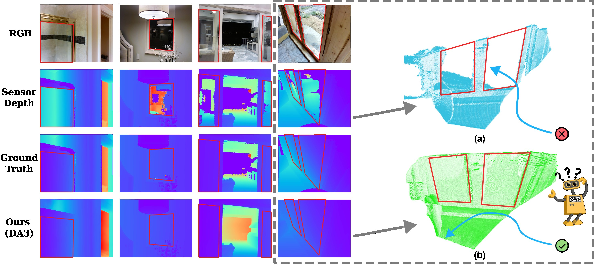

<div align="center">

# Enhancing Glass Surface Reconstruction via Depth Prior for Robot Navigation

### [Project Page](https://jarvisyjw.github.io/GlassRecon/) | [arXiv](https://arxiv.org/abs/2604.18336) | [Code](https://github.com/jarvisyjw/GlassRecon) | [Dataset (Google Drive)](https://drive.google.com/file/d/1u1ODwddeW04bkQ4oda9vgvbKK8MXTQ5N/view?usp=sharing)

[](https://jarvisyjw.github.io/GlassRecon/)

Our method, combined with Depth Anything 3 (DA3), achieves superior performance on glass surface
(red bounding box) depth estimation compared to raw depth sensor measurements, providing accurate
geometry for robot navigation in indoor environments. **(a)** points reconstructed from the sensor
depth — the robot might misperceive the glass as traversable, leading to a collision. **(b)** points
from our estimated depth.

</div>

GlassRecon aligns relative depth predictions with RGB-D sensor measurements to recover metric depth and reconstruct scenes with glass surfaces.

## Sample demo


The GIF shows an apartment, a conference room, and an office from ScanNet++ v2. The panels show RGB, depth rendered from raw sensor fusion, and depth rendered from GlassRecon’s sliding-window reconstruction. See the [scene IDs, evaluation results, and reproduction commands](docs/scannetpp.md).


nvblox reconstructed both colored point clouds for apartment `c0f5742640` from the same 468 frames and COLMAP poses. Raw sensor depth produced 1,173,576 points (left). GlassRecon produced 447,008 points (right) after aligning DA3-LARGE predictions to sensor depth and refining them over a five-frame window. Both views use the original PLY colors and the same viewing direction. Each panel fits its entire cloud and shows a one-meter scale bar.

## Dataset

The GlassRecon dataset contains RGB images, sensor depth and annotated glass depth maps from indoor scenes. [Download the dataset (Google Drive)](https://drive.google.com/file/d/1u1ODwddeW04bkQ4oda9vgvbKK8MXTQ5N/view?usp=sharing).

```
GlassRecon/
├── images/                  # RGB images (PNG)
├── intrinsics/              # JSON files with camera intrinsics & depth scale
├── masks/                   # Binary masks for glass regions (PNG)
├── sensor_depths/           # Raw sensor depth maps (PNG)
├── completed_depths/        # Completed depth maps (NPY)
└── evaluation_depths/
    ├── depths_npy/          # Filtered depth maps (NPY) – glass regions that could not be completed are masked out
    ├── depths_vis/          # Visualizations (PNG)
    └── pointclouds/         # 3D point clouds (PLY) - back-projected from depths_npy using intrinsics
```

With the DA3 environment active, generate one `.npy` prediction per RGB image. The predictor keeps each image's filename stem so the evaluator can match it to the sensor and ground-truth depth files. [Environment setup](#environment-setup) · [Evaluation](#evaluation)

```bash
dataset=/path/to/GlassRecon
python -m glassrecon predict \
  --image-folder "$dataset/images" \
  --model da3 --model-id depth-anything/DA3-LARGE --device cuda \
  --output outputs/glassrecon_predictions
```

## Usage

### Environment Setup

GlassRecon uses **DA3-LARGE for relative-depth prediction** and **nvblox for CUDA TSDF reconstruction**. Run the commands from the repository root with an NVIDIA GPU. Create separate Python 3.12 environments for prediction and reconstruction to accommodate the nvblox wheel's PyTorch and NumPy requirements.

The nvblox requirements below target Linux x86_64, Ubuntu 24.04, and CUDA 12. See the [nvblox installation guide](docs/nvblox.md#environment) for platform requirements and wheel details. Choose either uv or Conda.

**uv**

```bash
# DA3-LARGE frontend
uv venv --python 3.12 .venv-da3
uv pip install --python .venv-da3/bin/python -e .
uv pip install --python .venv-da3/bin/python \
  'git+https://github.com/ByteDance-Seed/Depth-Anything-3.git'

# nvblox backend and viewer
uv venv --python 3.12 .venv-nvblox
UV_SKIP_WHEEL_FILENAME_CHECK=1 uv pip install \
  --python .venv-nvblox/bin/python -r requirements-nvblox-cu12.txt
```

**Conda**

```bash
# DA3-LARGE frontend
conda create -n glassrecon-da3 python=3.12 pip
conda activate glassrecon-da3
python -m pip install -e .
python -m pip install 'git+https://github.com/ByteDance-Seed/Depth-Anything-3.git'

# nvblox backend and viewer
conda create -n glassrecon-nvblox python=3.12 pip
conda activate glassrecon-nvblox
python -m pip install uv
UV_SKIP_WHEEL_FILENAME_CHECK=1 uv pip install \
  --python "$(which python)" -r requirements-nvblox-cu12.txt
```

The scoped uv setting handles the official nvblox wheel's filename/version mismatch. DA3 downloads its checkpoint on first inference. See the [DA3 installation notes](https://github.com/ByteDance-Seed/Depth-Anything-3#-quick-start) for GPU dependency setup.

### Quick Start

Use the prepared apartment demo containing RGB, scale-aligned metric depth from DA3-LARGE, intrinsics, and supplied COLMAP camera poses. This entry point requires the nvblox environment above. Activate it with `source .venv-nvblox/bin/activate` (uv) or `conda activate glassrecon-nvblox` (Conda).

The locally generated demo archive `outputs/mapping_demo.tar.gz` contains `mapping_demo/`. Extract it under `outputs/` to run the commands below. It has not been uploaded to a public download location. The [Sample demo](#sample-demo) shows the complete apartment point cloud. To prepare it from an existing ScanNet++ experiment, run:

```bash
python examples/prepare_mapping_demo.py \
  --dataset data/scannetpp/c0f5742640 \
  --depth-cache outputs/scannetpp/c0f5742640/multiview_depths \
  --output outputs/mapping_demo
```

The demo contains only the 468 fused frames, with matching RGB, final metric depth, and poses. Its manifest records the expected frame count and processing configuration. It currently needs the local experiment outputs described in the [ScanNet++ guide](docs/scannetpp.md).

Run direct nvblox mapping and display the accumulating map:

```bash
python -m glassrecon reconstruct \
  --dataset outputs/mapping_demo \
  --intrinsics outputs/mapping_demo/intrinsics.json \
  --depth-source metric --depth-units-per-meter 1 \
  --pose-source file --pose-file outputs/mapping_demo/poses.txt \
  --backend nvblox --voxel-size 0.02 --sdf-trunc 0.08 \
  --live-view --keep-viewer --viewer-port 8090 \
  --output outputs/demo_mapping
```

Open [Viser](http://127.0.0.1:8090) to inspect mapping. Final outputs include `mesh.ply`, `pointcloud.ply`, `trajectory.txt`, `config.json`, and `summary.json`. The prepared metric-depth mode uses depths directly. Use a new output directory for each run.

### Complete Pipeline

Start with registered RGB-D, camera intrinsics, and supplied ground-truth camera poses. The complete runner executes DA3-LARGE prediction, sensor-based scale alignment, five-frame depth refinement, and nvblox mapping in sequence.

```text
RGB → DA3-LARGE → relative depth → scale alignment → window refinement → nvblox
                                          ↑                 ↑              ↑
                                     sensor depth       GT poses       RGB + GT poses
```

Use TUM-format `rgb.txt` and `depth.txt` indexes. Poses use `timestamp tx ty tz qx qy qz qw`, camera-to-world transforms, and translations in meters. For uv environments:

```bash
.venv-nvblox/bin/python examples/run_full_pipeline.py \
  --dataset /path/to/rgbd_sequence \
  --rgb-folder /path/to/rgbd_sequence/rgb \
  --intrinsics /path/to/intrinsics.json \
  --poses /path/to/groundtruth.txt \
  --model-python "$PWD/.venv-da3/bin/python" \
  --mapping-python "$PWD/.venv-nvblox/bin/python" \
  --depth-units-per-meter 5000 \
  --live-view --output outputs/full_pipeline
```

For Conda, activate `glassrecon-nvblox` and run the same script with `--model-python /absolute/path/to/envs/glassrecon-da3/bin/python`; omit `--mapping-python` to use the active Python. The first inference downloads the DA3-LARGE checkpoint.

The runner saves `predictions/` and `reconstruction/` under the output directory. Use fresh output directories. To inspect a completed result:

```bash
python -m glassrecon view --result outputs/full_pipeline/reconstruction --port 8090
```

For independent stages, use `python -m glassrecon predict`, followed by `reconstruct --model cached --prediction-dir ... --backend nvblox`. The [ScanNet++ reproduction guide](docs/scannetpp.md) specifies the comparison protocol, supplied COLMAP poses, and depth scale of 1000 units per meter used for the results below.

#### Fused Point Cloud Comparison

The ScanNet++ v2 apartment views below use DA3-LARGE predictions and nvblox fusion. They show the input RGB frame and the fused point clouds from raw sensor depth, global alignment, and regional alignment, from left to right.


<video src="experiments/results/scannetpp_v2/pointcloud_videos/c0f5742640.mp4" controls preload="metadata" width="100%"></video>

[Apartment video](experiments/results/scannetpp_v2/pointcloud_videos/c0f5742640.mp4) · [Conference room comparison](experiments/results/scannetpp_v2/pointcloud_videos/791a5c253d_interior.jpg) · [Office comparison](experiments/results/scannetpp_v2/pointcloud_videos/8a20d62ac0_interior.jpg)

[Reproduce the ScanNet++ demo with nvblox](docs/scannetpp.md)

### Mapping with Estimated Poses

The initial release provides RGB-D odometry and an external trajectory interface. Dedicated SLAM/VIO frontend integration is planned for a later release.

The complete runner also supports the existing RGB-D odometry frontend. Omit `--poses` to estimate camera motion from RGB and original sensor depth while DA3-LARGE predictions provide the aligned mapping depth. Reconstruction uses nvblox. The odometry implementation is Open3D hybrid RGB-D odometry.

An external SLAM/VIO frontend can supply its final trajectory through `--poses`, converted to the camera-to-world TUM convention above. VIO trajectories must be transformed from the IMU/body frame to the RGB camera frame and synchronized to image timestamps. For trajectories with loop-closure corrections, supply the final optimized trajectory before reconstruction.

## Evaluation

The paper's evaluator compares global least-squares alignment and regional RANSAC alignment against the filtered ground-truth depth maps. It reports mean absolute relative error (AbsRel) and the fraction of valid pixels with δ < 1.25. [Evaluation script](eval.py) · [Original evaluation code](https://github.com/JMamie/GlassRecon)

Run the evaluator on the matching files from the [GlassRecon dataset](#dataset). Set `depth_scale` to meters per stored unit for the sensor and ground-truth files (`1.0` for meters or `0.001` for millimeters).

```bash
python -m pip install -e '.[legacy]'
dataset=/path/to/GlassRecon
depth_scale=1.0
python eval.py \
  --image-folder "$dataset/images" \
  --pred-folder outputs/glassrecon_predictions \
  --sensor-depth-folder "$dataset/sensor_depths" \
  --gt-depth-folder "$dataset/evaluation_depths/depths_npy" \
  --depth-scale "$depth_scale" \
  --outdir outputs/glassrecon_eval
```

For inverse-depth predictions, append `--inverse-depth` to the same command. Per-image and overall scores are saved to `outputs/glassrecon_eval/eval_results.txt`.

## Citation

If you use GlassRecon in your research, please cite this paper.

```bibtex
@article{zheng2026enhancing,
  title={Enhancing Glass Surface Reconstruction via Depth Prior for Robot Navigation},
  author={Zheng, Jiamin and Yu, Jingwen and Chen, Guangcheng and Zhang, Hong},
  journal={arXiv preprint arXiv:2604.18336},
  year={2026}
}
```
