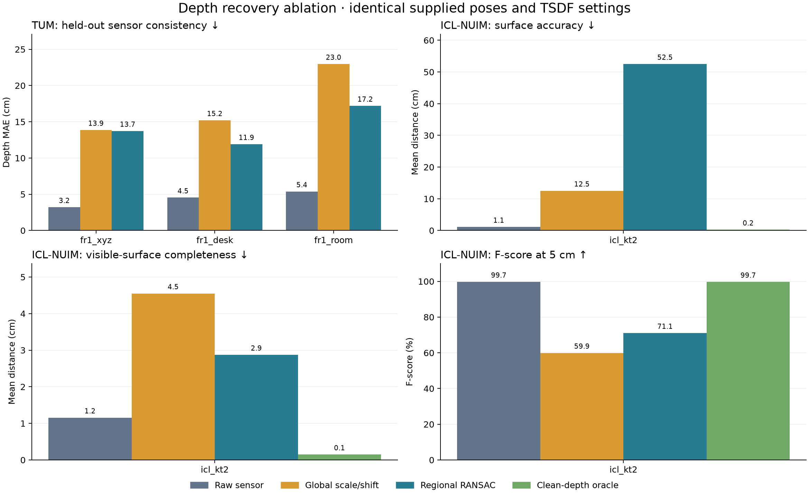

<div align="center">
    
# Enhancing Glass Surface Reconstruction via Depth Prior for Robot Navigation

### [Paper](https://arxiv.org/abs/2604.18336) | [GlassRecon Dataset](https://drive.google.com/file/d/1u1ODwddeW04bkQ4oda9vgvbKK8MXTQ5N/view?usp=sharing)


</div>

## RGB-D scale recovery and reconstruction

NVIDIA nvblox is available as a CUDA reconstruction backend via `--backend nvblox`.
See [installation, sequential mapping, and cached comparison reruns](docs/nvblox.md).
The existing Open3D backend remains available for CPU use and earlier experiments.

This repository also provides a modular pipeline for recovering metric depth from
relative depth predictions and noisy or incomplete RGB-D measurements:

```text
RGB → DA3 / DA2 / cached prediction → regional RANSAC scale + shift → metric depth
                                                   ↑
                                         registered sensor depth
RGB + sensor depth → RGB-D odometry → camera poses (or supplied poses)
Metric depth + camera poses → cumulative TSDF → mesh + point cloud
```

The pipeline is independent of glass segmentation. It supports TUM RGB-D sequences
and other sensors exported in the same timestamped format. It processes frames one
at a time; only the TSDF map grows with scene size.

### Installation

Use Python 3.10–3.12 (3.12 recommended). Keep model dependencies in a virtual environment:

```bash
python3.12 -m venv .venv
source .venv/bin/activate
python -m pip install -e '.[mapping,dev]'
```

For Depth Anything 3, install the official package and its PyTorch dependencies:

```bash
python -m pip install 'git+https://github.com/ByteDance-Seed/Depth-Anything-3.git'
```

Follow the [upstream setup instructions](https://github.com/ByteDance-Seed/Depth-Anything-3#-quick-start)
for the PyTorch/CUDA/xformers versions appropriate to your GPU. DA3's upstream
dependencies currently require NumPy < 2. The first inference downloads model weights;
`--model-id /path/to/model` can use a local model directory. Model packages are loaded
only when their backend is selected.

For the alternative Depth Anything V2 backend:

```bash
python -m pip install -e '.[da2]'
```

Cached predictions and the raw-sensor baseline need only the base and `mapping`
dependencies, with no PyTorch/model download. The original `eval.py` additionally
requires `python -m pip install -e '.[legacy]'`.

### Predict relative depth

```bash
python -m glassrecon predict \
    --image-folder /data/rgbd_dataset_freiburg1_desk/rgb \
    --model da3 --model-id depth-anything/DA3-LARGE --device cuda \
    --output outputs/desk_predictions
```

DA3 now defaults to `depth-anything/DA3-LARGE`. Select
`--model-id depth-anything/DA3-SMALL` to reproduce the earlier small-model runs.
Select `--model da2` for `depth-anything/Depth-Anything-V2-Small-hf`, or use
`--model-id` to select another checkpoint compatible with that backend. DA3 is
treated as relative **depth**; DA2's relative checkpoints as **inverse depth**.
Use relative checkpoints when studying scale recovery; metric/nested checkpoints
and metric-finetuned DA2 models are outside those adapter conventions. DA3 runs in
single-image mode, without providing camera poses or sensor depth to the network.
Its resize-only preprocessing preserves the full image field of view.

Outputs are float32 `<RGB-stem>.npy` arrays at the original RGB resolution, plus
`metadata.json` recording the model and depth convention. Values are raw relative
predictions, with no per-image min/max normalization. `--device auto` chooses CUDA
when available; `--process-res` controls DA3's inference resolution.

### Reconstruct a TUM sequence

Run prediction, metric alignment, RGB-D odometry, and TSDF fusion together:

```bash
python -m glassrecon reconstruct \
    --dataset /data/rgbd_dataset_freiburg1_desk \
    --model da3 --device cuda \
    --alignment local --pose-source odometry \
    --max-frames 100 --save-depths --save-predictions \
    --output outputs/desk_odometry
```

Use supplied camera poses to isolate reconstruction quality from tracking error:

```bash
python -m glassrecon reconstruct \
    --dataset /data/rgbd_dataset_freiburg1_desk \
    --model cached --prediction-dir outputs/desk_predictions \
    --pose-source file --pose-file /data/rgbd_dataset_freiburg1_desk/groundtruth.txt \
    --save-depths --output outputs/desk_fixed_poses
```

This explicitly uses ground-truth **poses** if `groundtruth.txt` is selected; it is
not a pose-estimation result. Sensor depth supplies the metric scale in both modes.
For external prediction folders without metadata, specify
`--prediction-space depth` or `--prediction-space inverse_depth`.

### Sequential reconstruction with live fusion

`reconstruct` processes all associated RGB-D pairs in timestamp order by default.
For each frame it predicts relative depth, recovers metric scale from the matching
sensor depth, estimates the camera pose relative to the last successfully tracked
frame, and integrates the recovered depth into the **same cumulative TSDF volume**.
The first pose defines the world origin. No ground-truth trajectory is read in
`--pose-source odometry` mode.

By default, pose tracking uses the original sensor RGB-D, while fusion uses the
recovered model depth. This separates motion estimation from frame-to-frame model
depth variation. `--tracking-depth aligned` instead feeds recovered depth into
odometry; use it as an experimental option when the sensor depth is unsuitable.

For the complete [TUM Freiburg1 XYZ sequence](https://cvg.cit.tum.de/data/datasets/rgbd-dataset/download#freiburg1_xyz),
run:

```bash
python -m pip install -e '.[mapping,viewer]'
# Install DA3 as described above, then:
python -m glassrecon reconstruct \
    --dataset data/rgbd_dataset_freiburg1_xyz \
    --model da3 --device auto --alignment local \
    --pose-source odometry --tracking-depth sensor --stride 1 \
    --live-view --viewer-every 10 --keep-viewer \
    --save-depths --save-predictions \
    --output outputs/fr1_xyz_sequential
```

Omit `--max-frames` to use the whole sequence. `--max-frames 100` limits the run to
the first 100 associated pairs; `--stride 1` uses consecutive pairs. A single input
frame only creates single-view geometry and cannot validate sequential tracking.

Viser displays processed/integrated/skipped counts, the current camera, the full
estimated path, and the cumulative fused surface. The map refreshes every
`--viewer-every` integrated frames and once at completion; the counters and camera
update each frame. `--viewer-max-points` caps only the displayed points. **Follow
current camera** follows the estimate, while **Frame scene** returns to an overview.
`--keep-viewer` leaves the viewer running after the artifacts are exported; Ctrl+C
then closes it. Without that flag the viewer closes when the command finishes.
The live surface is a point cloud; use `view --result OUTPUT` afterward to inspect
the final mesh as well.

The default URL is `http://127.0.0.1:8080` **on the machine running reconstruction**.
For direct LAN access, set `--viewer-host` to that machine's LAN IP and open that
IP in your browser, or use the SSH port forwarding described below. Choose another
`--viewer-port` if a viewer is already running.

`progress.json` is updated atomically after each frame. `summary.json` records the
final frame counts, timestamp span, and estimated camera-path length. Failed
alignment/tracking stops the run by default; `--on-failure skip` logs and excludes
failed frames without inserting a fake pose. This is sequential offline mapping,
not a guarantee of sensor-rate processing or globally optimized SLAM.

Useful comparison controls:

| Option | Behavior |
| --- | --- |
| `--depth-source sensor` | Fuse raw sensor depth without loading a prediction model |
| `--alignment global` | Least-squares scale/shift baseline |
| `--alignment local` | Regional sampling and global absolute-error selection (default) |
| `--tracking-depth sensor` | Track with raw sensor depth while fusing recovered depth (default) |
| `--tracking-depth aligned` | Track with recovered depth; independent model predictions can cause temporal drift |
| `--rows 4 --cols 4 --samples 10 --iterations 100` | Sampling configuration; iterations are per partition |
| `--seed 0` | Repeatable alignment sampling for the same ordered frames |
| `--min-depth 0.1 --max-depth 10` | Valid sensor/fusion range in meters |
| `--voxel-size 0.02 --sdf-trunc 0.08` | TSDF voxel and truncation distances in meters |
| `--start 0 --stride 1 --max-frames 100` | Frame selection after RGB/depth association |
| `--on-failure skip` | Log and skip alignment/tracking failures; default is to stop |

Use the same supplied poses and frame selection for fair sensor/global/local map
comparisons. Large frame strides can make frame-to-frame odometry fail.

Every run writes `mesh.ply`, `pointcloud.ply`, camera-to-world `trajectory.txt` in
TUM format, `config.json`, `summary.json`, and per-frame `frames.jsonl` diagnostics.
Optional `metric_depths/*.npy` contain meters, with zero marking invalid pixels.
Optional `predictions/` can be reused as a cache. Output directories must be new or
empty to prevent mixing results.

### Interactive visualization with Viser

Install the lightweight viewer dependencies and open any reconstruction output:

```bash
python -m pip install -e '.[viewer]'
python -m glassrecon view --result outputs/desk_odometry --port 8080
```

Open the URL printed in the terminal (normally `http://127.0.0.1:8080`). The viewer
shows the colored mesh, point cloud, and camera trajectory. Use **Geometry** to
switch between mesh, point cloud, or both, adjust point size, and toggle the
trajectory. Click a camera frustum to view from that pose, use **First camera** to
return to the initial camera, or **Frame scene** for an overview. Drag to orbit,
right-drag to pan, and scroll to zoom. Stop the server with Ctrl+C.

The viewer reads `mesh.ply`, `pointcloud.ply`, optional `trajectory.txt`, and camera
calibration from `config.json`. It preserves metric world coordinates and vertex
colors. `--max-points 500000` and `--max-cameras 100` limit browser display load
without modifying the saved artifacts. It requires neither Open3D nor a model.

The server binds to localhost by default. For a remote reconstruction machine,
forward the port with `ssh -L 8080:127.0.0.1:8080 user@host`, then open the local URL.
`--host 0.0.0.0` is available for direct access on a trusted network. See the
[Viser documentation](https://viser.studio/main/) for its browser controls and API.

### Data and geometry conventions

The dataset root needs `rgb.txt` and `depth.txt`, each with `timestamp relative/path`
rows; `#` comments are accepted. Frames are paired one-to-one by closest timestamp
within `--max-time-difference` (default 0.02 seconds). RGB and depth must already be
registered to the same pixels and have the calibration's dimensions; incompatible
inputs are rejected rather than resized geometrically.

TUM PNG depths use **5000 units per meter**. For meter-valued NPY depth use
`--depth-units-per-meter 1`; for millimeter-valued depth use `1000`. This option is
a divisor, unlike the multiplicative `--depth-scale` in the legacy evaluator.
The published TUM depth correction factors are already applied to the dataset.

The default calibration is TUM's recommended ROS pinhole approximation
(`640×480`, `fx=fy=525`, `cx=319.5`, `cy=239.5`). For calibrated/rectified data, provide
`--intrinsics camera.json`:

```json
{"width": 640, "height": 480, "fx": 525.0, "fy": 525.0, "cx": 319.5, "cy": 239.5}
```

No distortion correction is applied. Custom sensors must be registered/rectified
before ingestion. See the [official TUM format and calibration notes](https://cvg.cit.tum.de/data/datasets/rgbd-dataset/file_formats).

Pose files contain `timestamp tx ty tz qx qy qz qw`, with translations in meters and
**camera-to-world** transforms. Poses are interpolated with linear translation and
quaternion SLERP. Missing endpoints or gaps exceeding `--pose-max-difference`
(default 0.05 seconds to either bracketing pose) are logged and excluded; there is
no extrapolation. Open3D integration receives the inverse, world-to-camera pose.

### Method and current scope

`glassrecon/alignment.py` is a NumPy implementation of the method in
`alignment_functions.py`: fit affine candidates from randomly sampled points in
each image partition, then choose the candidate with the lowest summed absolute
error over all valid sensor correspondences. Using the mean gives the same ranking.
It returns one scale and shift for the entire frame. For inverse-depth models the
sensor target is inverted before fitting, and the aligned prediction is inverted
back to metric depth afterward.

The new implementation uses float64 centered least squares, includes remainder
pixels at partition boundaries, supports seeded sampling, and rejects degenerate
or nonpositive-scale fits. It falls back to global fitting when valid points exist
but no regional candidate can be fitted. It never substitutes identity scale when
metric recovery fails. Invalid/nonpositive/out-of-range transformed predictions
become zero; sensor holes can be filled from valid model predictions. The original
evaluation files remain unchanged for reproducing their existing behavior.

This is an offline reconstruction baseline using Open3D hybrid RGB-D odometry and
scalable TSDF integration. It does not include loop closure, relocalization, global
pose optimization, temporal depth smoothing, or dynamic-object handling. Odometry
can drift; supplied poses help assess the depth method independently. Scale recovery
needs enough reliable sensor correspondences and depth variation. It cannot correct
an unknown systematic sensor scale bias without another metric reference. Sampling
and scoring all valid pixels prioritize matching the original method over real-time speed.

The interfaces follow the [DA3 API](https://github.com/ByteDance-Seed/Depth-Anything-3/blob/main/docs/API.md),
[DA2 model card](https://huggingface.co/depth-anything/Depth-Anything-V2-Small-hf),
[Open3D odometry](https://www.open3d.org/docs/release/tutorial/pipelines/rgbd_odometry.html),
and [Open3D integration](https://www.open3d.org/docs/release/tutorial/pipelines/rgbd_integration.html).

### Controlled depth-recovery comparisons

Run the experiment scripts **from the repository root**, with Python 3.12 and
`pip install -e '.[mapping,viewer,experiments,dev]'`. Install DA3 separately as above.
The download utility obtains official TUM Freiburg1 Desk/Room archives and the
clean/noisy [ICL-NUIM Living Room kt2](https://www.doc.ic.ac.uk/~ahanda/VaFRIC/iclnuim.html)
sequences. It resumes validated byte ranges, safely extracts archives, and records
source URLs and downloaded-file SHA-256 hashes in `data/downloads/`.

```bash
python -m experiments.download_data tum_desk tum_room
python -m experiments.download_data icl_mesh icl_kt2_clean icl_kt2_noisy
python -m experiments.prepare_icl

OMP_NUM_THREADS=4 OPENBLAS_NUM_THREADS=4 python -m experiments.run_comparison \
    --dataset data/rgbd_dataset_freiburg1_desk \
    --poses data/rgbd_dataset_freiburg1_desk/groundtruth.txt \
    --model da3 --model-id depth-anything/DA3-SMALL --device auto --output outputs/comparison_fr1_desk

OMP_NUM_THREADS=4 OPENBLAS_NUM_THREADS=4 python -m experiments.run_comparison \
    --dataset data/rgbd_dataset_freiburg1_room \
    --poses data/rgbd_dataset_freiburg1_room/groundtruth.txt \
    --model da3 --model-id depth-anything/DA3-SMALL --device auto --output outputs/comparison_fr1_room

OMP_NUM_THREADS=4 OPENBLAS_NUM_THREADS=4 python -m experiments.run_comparison \
    --dataset data/icl_kt2_noisy \
    --poses data/icl_kt2_noisy/groundtruth_opencv.txt \
    --intrinsics data/icl_reference/intrinsics.json \
    --reference-depth data/icl_kt2_clean \
    --reference-mesh data/icl_reference/living_room_opencv.ply \
    --model da3 --model-id depth-anything/DA3-SMALL --device auto --output outputs/comparison_icl_kt2
```

Each experiment fuses **raw sensor**, **global least-squares alignment**, and
**regional RANSAC alignment** with identical supplied ground-truth poses, frame
selection, RGB, depth limits, and TSDF settings. The scale-recovery methods receive
only the input sensor depth, never ICL's clean evaluation depth. ICL additionally
includes a separately labeled **clean-depth oracle** fusion control.

Every fifth associated frame is held out of prediction/alignment and fusion.
Frames without a supplied pose are excluded for every method and listed explicitly.
All remaining frames are processed in order across the entire sequence unless
`--max-frames` is specified. These are depth/fusion ablations with supplied poses,
not tracking or SLAM benchmarks. Regional fitting uses seed 0 by default, 4×4
partitions, 10 samples and 100 trials per partition; no thresholds are tuned per scene.

**Evaluation:**

- TUM: raycast each reconstructed mesh at held-out camera poses and compare with
  held-out sensor depth. This measures sensor-depth consistency, **not independent
  ground-truth surface accuracy**. Report MAE/RMSE/AbsRel on common rendered pixels,
  plus per-method render coverage and errors on its own support.
- ICL: the same held-out rendering test uses independent clean depth. Surface
  accuracy is estimated-mesh → reference-triangle distance using 100,000 area-uniform
  samples. Completeness is observed clean-reference points → estimated triangles.
  Also report symmetric mean distance and precision/recall/F-score at 2, 5 and 10 cm.
  Reference support uses every fifth fused clean frame at a four-pixel stride,
  voxelized to 1 cm, and is shared by all methods. Unseen room surfaces do not
  count as missing reconstruction. Neither ICP nor a fitted scale correction is used.
- A lower reconstruction error is not guaranteed: affine recovery corrects scale
  and shift, but cannot remove arbitrary shape errors or temporal inconsistency
  from the model. Keep negative results and separate coverage from accuracy.

ICL preprocessing keeps RGB/depth images upright and unchanged. It reflects both
native camera and world y to express the published negative `fy` with positive
OpenCV intrinsics (`fx=481.2`, `fy=480`). The authors' explicit
[POV-Ray geometry](https://github.com/ankurhanda/living_room_iclnuim)
supplies the reference triangles, including the original OBJ-to-renderer x reflection
and triangulation. Global native poses are matched to one-based image IDs; archive
frame 0 has no published pose and is excluded. Index timestamps are converted to
seconds at 30 Hz. Source hashes and conversion details are saved in
`data/icl_reference/provenance.json`. A clean-depth/reference-mesh coordinate check
must pass before surface metrics are accepted.

Each run saves `comparison.json`, `config.json`, `selection.json`, `frames.jsonl`,
prediction caches, and per-method meshes, point clouds and identical trajectories.
The ICL output additionally includes observed reference points and sampled surface
errors. Reuse predictions with `--model cached --prediction-dir PREVIOUS/predictions`;
the selected training frames must exist in that cache. Output folders must be new.

```bash
python -m experiments.render_examples \
    outputs/comparison_fr1_desk outputs/comparison_fr1_room outputs/comparison_icl_kt2 \
    --output outputs/comparison_report
python -m experiments.make_report \
    outputs/comparison_fr1_desk outputs/comparison_fr1_room outputs/comparison_icl_kt2 \
    --output outputs/comparison_report
python -m experiments.view_comparison \
    outputs/comparison_fr1_desk outputs/comparison_fr1_room outputs/comparison_icl_kt2 \
    --host 127.0.0.1 --port 8082
```

The report includes CSV metrics, PNG/PDF figures, and a local HTML report. The
example renderer selects each sequence's middle held-out frame deterministically
and uses the same error color scale across methods. Viser
switches methods while keeping the viewing camera fixed; ICL's observed reference
can be overlaid. For LAN viewing, replace `--host` with the reconstruction machine's
LAN address. Single-seed results are exploratory, not multi-seed statistical claims.

#### Evaluate a larger DA3 model

DA3-LARGE is the default predictor. The historical comparison commands above
explicitly select Small to preserve reproducibility. To repeat a completed run
with Large, retaining its frame split, supplied poses, alignment and TSDF settings:

```bash
OMP_NUM_THREADS=4 OPENBLAS_NUM_THREADS=4 python -m experiments.rerun_model \
    outputs/comparison_fr1_xyz --output outputs/comparison_large_fr1_xyz \
    --model-id depth-anything/DA3-LARGE --device cuda
```

Repeat for `fr1_desk`, `fr1_room`, and `icl_kt2`. Use a new output directory;
predictions are recomputed and the original Small artifacts are preserved.
`model_environment.json` records the resolved checkpoint, runtime, device and
DA3 autocast precision. Compare paired runs with:

```bash
python -m experiments.compare_models \
    --baseline outputs/comparison_fr1_xyz outputs/comparison_icl_kt2 \
    --candidate outputs/comparison_large_fr1_xyz outputs/comparison_large_icl_kt2 \
    --output outputs/comparison_large_report
```

This validates matching frame selections and reconstruction settings and exports
CSV/JSON metric differences. Common rendered pixels are selected within each run;
coverage may differ between models. The original Small runs used CPU inference,
so a Large GPU comparison also changes runtime/precision; it is not a strictly
isolated model-size ablation. Both run directories can be passed together to
`experiments.view_comparison` for Viser inspection.

#### Sliding-window multi-view depth recovery

`--fusion-policy multiview` jointly refines the metric depths initialized by regional
recovery. DA3-LARGE is still run once per image; this ablation deliberately reuses the
same single-image predictions. It does **not** switch to joint multi-image DA3 inference.

For each active frame the recovered depth becomes `z_i = alpha_i*z_initial_i + beta_i`.
The solver minimizes robust sensor-anchor and pose-aware 3D correspondence residuals,
plus a weak identity-correction prior. For a matched ray pair, the geometric residual is
`R_ji * ray_i * z_i + t_ji - ray_j * z_j`. The coefficients of all active frames are
optimized together using Huber IRLS. Observed sensor depth supplies projection,
z-buffer visibility and depth-agreement tests; RGB agreement and interior masks reject
additional ambiguous correspondences. Clean reference depth is never an optimizer input.

Default settings are fixed across scenes: five active frames, eight-pixel sampling,
temporal weight 1, five IRLS iterations, Huber threshold 1.5 in normalized residual units,
and minimum 30 correspondences per pair. Sensor residuals use `0.03 + 0.01*z` meter
normalization. Group means balance frames/pairs, and a weak prior limits correction drift.
These are heuristic settings, not thresholds fitted to the ICL evaluation mesh.

This is a **fixed-lag** implementation: the oldest active frame is finalized after four
additional valid frames arrive. It is fused once and retained as a fixed boundary anchor
for the next window. Already fused frames are never altered or integrated again. End-of-
sequence flushing emits the final buffered frames. Pose estimation remains independent;
the normal CLI supports sensor RGB-D odometry or supplied poses.

```bash
python -m glassrecon reconstruct --dataset DATASET --output NEW_MAP \
    --model da3 --model-id depth-anything/DA3-LARGE --device cuda \
    --fusion-policy multiview --window-size 5 --temporal-weight 1 \
    --tracking-depth sensor --save-depths

# Repeat the controlled experiments from completed Large caches; no inference changes.
python -m experiments.run_multiview outputs/comparison_large_fr1_xyz \
    --output outputs/comparison_multiview_fr1_xyz
# Repeat for fr1_desk, fr1_room and icl_kt2.
python -m experiments.visualize_multiview \
    outputs/comparison_multiview_fr1_xyz outputs/comparison_multiview_fr1_desk \
    outputs/comparison_multiview_fr1_room outputs/comparison_multiview_icl_kt2 \
    --output outputs/multiview_visuals
```

All four runs completed with identical cached DA3-LARGE predictions, supplied GT poses,
frame selection and TSDF settings: 2,873 fused frames and 720 held-out frames. Held-out
frames never enter the optimization windows. A **sensor-anchor-only** control uses the
same fitting objective with cross-view terms removed. Window depth caches and final
coefficients are stored separately in `outputs/comparison_multiview_*_depths`; per-frame
and window reconstructions use the same depth limits and integration weights.

TUM held-out sensor-consistency MAE, cm (common pixels across methods in these runs):

| Sequence | Raw sensor | Per-frame regional | Sensor-anchor only | Sliding window |
| --- | ---: | ---: | ---: | ---: |
| XYZ | 3.237 | 6.446 | 6.506 | 6.435 |
| Desk | 4.642 | 7.078 | 7.038 | 6.901 |
| Room | 5.456 | 10.552 | 10.430 | 10.331 |

ICL independent surface accuracy:

| Method | Mean surface error (cm) ↓ | F-score @ 5 cm (%) ↑ |
| --- | ---: | ---: |
| Raw sensor | 1.115 | 99.736 |
| Per-frame regional | 3.043 | 90.118 |
| Sensor-anchor only | 3.300 | 86.564 |
| Sliding window | 3.316 | 86.293 |

The result is mixed: modest TUM consistency gains, but worse ICL surface accuracy.
In ICL's diagnostic sample, adjacent-view reprojection RMSE improves from 2.65 to
2.55 cm, while the 30-frame-gap error increases from 6.37 to 6.51 cm. Most of the ICL
surface degradation is already present in the sensor-anchor-only control. Thus local
agreement does not establish better reconstruction, and a joint affine correction
cannot resolve arbitrary local shape errors. The previous default remains unchanged.

Diagnostics use up to 24 uniformly spaced fused target frames, with 1/10/30-frame gaps.
ICL visibility uses clean geometry **only during evaluation**; TUM uses sensor-stable
interiors, which favors sensor stability. All methods share valid support within each
pair. Gallery images show relative depth, raw depth, per-frame recovery, anchor-only
refitting, window recovery, signed corrections and error maps on common color scales.
The middle and worst sensor-fit frames are selected without clean-GT error ranking.
These are development-sequence, single-seed comparisons; they are not untouched benchmarks.

Results: [`experiments/results/da3_multiview`](experiments/results/da3_multiview).
Visual report: `outputs/multiview_visuals/index.html` and `report.html`.
Viser accepts all four `outputs/comparison_multiview_*` result directories; the current
LAN viewer uses port 8086. Serve only `outputs/multiview_visuals` for the browser report
(currently port 8087), rather than exposing unrelated output directories.

#### Additional TUM sequences

The fixed extension in [`experiments/tum_extension.json`](experiments/tum_extension.json)
adds Freiburg1 Desk2, Freiburg1 Plant, Freiburg2 Desk, and Freiburg3 Long Office Household.
These sequences were selected before examining their recovery results. The model checkpoint,
seed, regional recovery, five-frame window, and TSDF parameters remain fixed; there is no
frame cap or sequence-specific parameter search. All frames with valid RGB/depth and pose
associations are considered, with every fifth associated frame held out as before.

Freiburg1/2 retain the ROS-default camera approximation used in the earlier experiments.
Freiburg3 uses its published RGB calibration (`fx=535.4, fy=539.2, cx=320.1, cy=247.6`)
because those images are already undistorted. Each sequence uses identical calibration and
supplied GT poses across all methods. See the
[TUM calibration notes](https://cvg.cit.tum.de/data/datasets/rgbd-dataset/file_formats).
These comparisons evaluate depth/fusion consistency, not estimated tracking performance or
independent surface accuracy.

The Freiburg2 Desk archive contains two different ground-truth poses at timestamp
`1311868229.5760`. Both ambiguous samples are omitted from a separate prepared pose file;
the original archive and trajectory remain unchanged. A receipt records the removed rows
and both file hashes. The interpolation gap limit remains 0.05 seconds, and every method
uses the same prepared trajectory. The runner applies this duplicate-timestamp policy
before inference; sequences without duplicate timestamps use their original pose file.

```bash
python -m experiments.download_data tum_desk2 tum_plant tum_fr2_desk tum_fr3_office --workers 12

# Use the DA3 environment and HF_HOME containing the pinned Large checkpoint.
OMP_NUM_THREADS=4 OPENBLAS_NUM_THREADS=4 python -m experiments.run_tum_extension
# Or select individual sequences with --sequences fr1_desk2 fr1_plant.
# Completed matching experiments are reused; partial output directories are preserved.

python -m experiments.summarize_tum_extension
python -m experiments.visualize_multiview \
    outputs/comparison_multiview_fr1_desk2 outputs/comparison_multiview_fr1_plant \
    outputs/comparison_multiview_fr2_desk outputs/comparison_multiview_fr3_office \
    outputs/comparison_multiview_fr1_xyz outputs/comparison_multiview_fr1_desk \
    outputs/comparison_multiview_fr1_room outputs/comparison_multiview_icl_kt2 \
    --output outputs/tum_extended_visuals
```

The audit verifies identical selections, camera trajectories, prediction-cache membership,
window latency, and boundary-frame ordering. Compact configurations, download receipts,
selections, and metrics are saved under `experiments/results/da3_tum_extension`.
The combined depth gallery and report are written to `outputs/tum_extended_visuals`.
Pass the same eight result directories to `python -m experiments.view_comparison`
to compare the reconstructed meshes in Viser.

All four additional runs completed: **5,130 fused frames and 1,278 held-out frames**.
Including the earlier sequences, the TUM comparison now covers seven sequences.
Held-out sensor-consistency MAE in centimeters, using common rendered support within
each sequence (lower is better):

| Sequence | Raw sensor | Per-frame regional | Sensor-anchor only | Sliding window |
| --- | ---: | ---: | ---: | ---: |
| Freiburg1 Desk2 | 6.520 | 9.565 | 9.446 | 9.333 |
| Freiburg1 Plant | 11.282 | 33.145 | 31.445 | 31.555 |
| Freiburg2 Desk | 20.168 | 25.173 | 25.037 | 24.924 |
| Freiburg3 Long Office Household | 6.451 | 17.594 | 17.014 | 16.799 |

The window improves over the original per-frame recovery by 1.0–4.8% on these four
sequences, but raw depth has the lowest held-out error throughout. Most of the mean
improvement is already present in the sensor-anchor-only control; adding cross-view
constraints helps three sequences slightly and worsens Plant slightly. The mean of
the four sequence MAEs is 21.369 cm for per-frame recovery, 20.736 cm for anchor-only,
and 20.653 cm for the window. These single-seed measurements do not establish a
statistically significant improvement or independent surface accuracy.

All frame-selection, trajectory, cache-membership, and fixed-lag audits passed.
Four Plant windows and two Office windows rejected an unsafe update and retained
their previous safe coefficients; every selected frame was still fused exactly once.
The high Freiburg2 Desk mean includes a long tail of large residuals: a separate
24-view raw-depth diagnostic has per-view medians of 1.41–7.70 cm. Its exact views and
all-valid-pixel statistics are preserved in
[`fr2_desk_raw_heldout_diagnostic.json`](experiments/results/da3_tum_extension/fr2_desk_raw_heldout_diagnostic.json).

Full results and audit:
[`experiments/results/da3_tum_extension`](experiments/results/da3_tum_extension).
The updated LAN gallery is on port 8087 and the eight-sequence Viser viewer (seven
TUM sequences plus the existing ICL control) is on port 8086.

#### Failure analysis and conservative fusion with DA3-LARGE

The recovery transform corrects scale and shift, not spatial shape. Replacing all
sensor measurements with recovered predictions discards accurate interior depth,
smooths thin structures and depth discontinuities, and introduces frame-to-frame
shape changes. A single-frame average also overweights sensor boundary outliers:
in the ICL diagnostic sample, sensor-interior MAE is **1.40 cm** for raw depth and
**4.61 cm** for regional recovery. On a shared, reprojected sensor-interior overlap,
temporal RMSE is **1.79 cm** for sensor depth and **2.89 cm** for recovered depth.
Temporal stability is diagnostic, not ground-truth accuracy. These findings explain
why lower aggregate input-depth MAE need not produce a more accurate TSDF mesh.

An optional policy now separates scale estimation from fusion:

```bash
python -m glassrecon reconstruct --dataset DATASET --output NEW_OUTPUT \
    --model da3 --model-id depth-anything/DA3-LARGE --device cuda \
    --fusion-policy conservative --tracking-depth sensor --save-depths
```

- Regional fitting remains unchanged. An additional robust IRLS affine refit uses
  non-edge sensor anchors; it is accepted only if disjoint sensor validation pixels
  improve. It never uses clean reference depth. This refit is an ablation, not a
  demonstrated improvement in reconstruction accuracy.
- Sensor filtering rejects isolated spikes and averages nearby depth/RGB-compatible
  measurements. It preserves observed depth discontinuities and leaves holes invalid.
- Completion corrects recovered model depth using neighboring sensor residuals.
  At least five compatible neighboring anchors, low residual variance, and agreement
  with the previous sensor frame reprojected using camera poses are required.
  Only observed sensor depths enter history, preventing predicted fills from
  validating later predictions. Unsupported holes remain empty.
- If affine recovery is unidentifiable, conservative mode retains filtered sensor
  depth instead of discarding the entire frame. The legacy `replace` policy remains
  the default for paper reproduction; opt into `conservative` explicitly.

The thresholds are fixed heuristics, not calibrated confidence probabilities:
noise tolerance `0.01 + 0.005*z²` meters; 5×5 local neighborhoods; two-tolerance
cross-view agreement. The current Open3D TSDF receives admitted depth values with
its ordinary integration weights. This is input gating, **not** a custom weighted
TSDF implementation. Pose errors, dynamic objects and systematic sensor bias can
still invalidate confidence assumptions.

Repeat a completed Large run with identical predictions and original recovery fits:

```bash
python -m experiments.run_refinement outputs/comparison_large_icl_kt2 \
    --output outputs/comparison_refined_icl_kt2
python -m experiments.inspect_depth \
    outputs/comparison_large_fr1_xyz outputs/comparison_large_fr1_desk \
    outputs/comparison_large_fr1_room outputs/comparison_large_icl_kt2 \
    --output outputs/depth_failure_analysis
```

The same command was run for XYZ, Desk, Room and ICL: 2,873 fused and 720 held-out
frames, identical cached DA3-LARGE predictions, supplied GT poses, and TSDF settings.
The six non-oracle methods share a common rendered-pixel intersection **within the
new runs**; this support differs slightly from the earlier three-method comparison.
TUM held-out sensor-consistency MAE (cm):

| Sequence | Raw sensor | Regional replacement | Robust refit only | Filtered sensor | Conservative completion |
| --- | ---: | ---: | ---: | ---: | ---: |
| XYZ | 3.243 | 6.466 | 6.470 | 3.229 | 3.230 |
| Desk | 4.651 | 7.105 | 7.099 | 4.635 | 4.634 |
| Room | 5.467 | 10.606 | 10.605 | 5.449 | 5.452 |

ICL independent surface metrics:

| Method | Mean surface error (cm) ↓ | Completeness distance (cm) ↓ | F-score @ 5 cm (%) ↑ |
| --- | ---: | ---: | ---: |
| Raw noisy sensor | 1.115 | 1.156 | 99.736 |
| Regional replacement | 3.043 | 2.909 | 90.118 |
| Robust refit only | 3.055 | 2.917 | 89.448 |
| Filtered sensor only | 1.129 | 1.186 | 99.718 |
| Conservative completion | 1.132 | 1.186 | 99.722 |

Conservative fusion greatly improves over full model replacement but **does not
beat raw ICL sensor fusion**. Most improvement comes from retaining sensor geometry;
the model contributes just 0.42% of all ICL input pixels (0.45–0.54% on TUM). In the
diagnostic sample it fills 8.49% of sensor holes, so low error on accepted fills must
not be confused with dense completion. Robust refitting alone does not improve the
ICL mesh. Do not attribute filtering gains to the scale-recovery algorithm.

The diagnostic HTML contains before/after depth maps, shared metric color scales,
error maps, affine-fit scatter plots and source masks. DA3 relative depth has a
separate arbitrary-unit colorbar. Examples are the middle fused frame and the worst
sensor-fit frame, selected without clean GT; quantitative diagnostics additionally
sample 24 uniformly spaced fused frames. The sample is exploratory. These sequences
have now been inspected during development; an untouched sequence, corruption
ablations and repeated seeds are needed before making paper-level claims.

Artifacts: `outputs/depth_failure_analysis/index.html`,
`outputs/comparison_refined_report/report.html`, and compact reproducible results
in [`experiments/results/da3_refinement`](experiments/results/da3_refinement).
Viser accepts the four `outputs/comparison_refined_*` run directories and includes
all six methods plus ICL's clean oracle. Example deployment uses port 8084; serve
only `outputs/depth_failure_analysis` on port 8085 for the diagnostic figures.

#### Recorded comparison: DA3-LARGE versus DA3-SMALL

The 2026-11-11 Large rerun uses the relative-depth `depth-anything/DA3-LARGE`
checkpoint (410,941,767 parameters), revision
`c54c26b16ec04d218e8d584ecf4bce082a9fcc20`. All four full-sequence runs completed:
2,873 fused frames and 720 held-out frames. Frame selections, saved camera
trajectories, alignment parameters and fusion/evaluation settings match Small.
Compact results, paired metric differences and runtime provenance are in
[`experiments/results/da3_large`](experiments/results/da3_large).

Regional recovery, TUM held-out sensor-depth MAE (cm, lower is better):

| Sequence | Small | Large | Raw sensor, Large-run common support |
| --- | ---: | ---: | ---: |
| Freiburg1 XYZ | 13.73 | 6.47 | 3.25 |
| Freiburg1 Desk | 11.91 | 7.11 | 4.66 |
| Freiburg1 Room | 17.19 | 10.64 | 5.50 |

ICL-NUIM kt2 regional recovery against the independent reference geometry:

| Metric | Small | Large | Raw noisy sensor |
| --- | ---: | ---: | ---: |
| Mean surface error (cm) ↓ | 52.51 | 3.04 | 1.12 |
| Median surface error (cm) ↓ | 3.52 | 1.63 | 0.99 |
| Completeness distance (cm) ↓ | 2.87 | 2.91 | 1.16 |
| F-score at 5 cm (%) ↑ | 71.06 | 90.12 | 99.74 |

Large substantially reduces the severe erroneous geometry: the fraction of
area-uniform reconstructed-surface samples farther than 50 cm from the reference
drops from 26.45% to 0.173%. Completeness does not improve, and raw sensor fusion
still outperforms full recovered-depth replacement on these sequences. With Large,
regional recovery improves ICL mean surface error over global fitting
(3.04 versus 5.25 cm), and F-score (90.12% versus 59.56%).

These are single-seed results. Small used CPU/float16 inference; Large used
CUDA/bfloat16 with a different PyTorch version. Common rendered support can also
differ across models. Thus the results demonstrate the tested Large configuration,
not a strictly isolated model-size effect. No parameters were retuned for Large.

The local full report is `outputs/comparison_large_report/report.html`, with
CSV/JSON differences, figures and held-out error examples. To view both model sizes:

```bash
python -m experiments.view_comparison \
    outputs/comparison_large_fr1_xyz outputs/comparison_fr1_xyz \
    outputs/comparison_large_fr1_desk outputs/comparison_fr1_desk \
    outputs/comparison_large_fr1_room outputs/comparison_fr1_room \
    outputs/comparison_large_icl_kt2 outputs/comparison_icl_kt2 \
    --host 192.168.8.225 --port 8083
```

#### Recorded comparison: DA3-SMALL, seed 0

The 2026-11-11 run used the protocol above. Compact JSON results, CSV, model revision,
ICL conversion provenance and PNG/PDF figures are preserved in
[`experiments/results`](experiments/results). Large inputs, prediction caches and
meshes remain under the ignored `data/` and `outputs/` directories.

TUM held-out depth MAE on common rendered pixels (cm, lower is better):

| Sequence | Fused / held out | Raw sensor | Global fit | Regional recovery |
| --- | ---: | ---: | ---: | ---: |
| Freiburg1 XYZ | 630 / 158 | 3.21 | 13.87 | 13.73 |
| Freiburg1 Desk | 458 / 115 | 4.54 | 15.20 | 11.91 |
| Freiburg1 Room | 1081 / 271 | 5.38 | 22.97 | 17.19 |

ICL-NUIM kt2 used 704 fused and 176 held-out frames from the official noisy input:

| Fusion depth | Mean surface error (cm) ↓ | Median surface error (cm) ↓ | Completeness distance (cm) ↓ | F-score @ 5 cm (%) ↑ |
| --- | ---: | ---: | ---: | ---: |
| Raw noisy sensor | 1.12 | 0.99 | 1.16 | 99.74 |
| Global fit | 12.53 | 4.50 | 4.55 | 59.94 |
| Regional recovery | 52.51 | 3.52 | 2.87 | 71.06 |
| Clean-depth oracle | 0.24 | 0.12 | 0.15 | 99.70 |

Regional recovery improves the TUM consistency MAE and ICL median/completeness/F-score
relative to global fitting in these runs. It **does not beat raw sensor fusion** in
this DA3-SMALL full-depth-replacement configuration. ICL's regional result has a
large error tail: the 95th percentile surface distance is 2.40 m, despite a 3.52 cm
median. Keep these outlier surfaces in the reported mean; do not crop or rescale
the output to hide them. The clean oracle's 2.4 mm mean error and the independent
clean-depth/reference coordinate check (1.09 mm median) provide controls on the
fusion and evaluation setup. This finding concerns the tested checkpoint and fusion
policy, not every possible use of the scale-recovery method.



### Download-free smoke test

```bash
python examples/make_synthetic_sequence.py --output outputs/synthetic_input
python -m glassrecon reconstruct \
    --dataset outputs/synthetic_input --intrinsics outputs/synthetic_input/intrinsics.json \
    --model cached --prediction-dir outputs/synthetic_input/predictions \
    --pose-source file --pose-file outputs/synthetic_input/groundtruth.txt \
    --save-depths --output outputs/synthetic_map
python -m pytest
```

The synthetic scene has known camera motion, a slanted metric plane, sensor holes,
and localized sensor corruption. Tests cover affine recovery, inverse depth, invalid
measurements, timestamp/pose handling, and actual Open3D fusion. Mapping tests are
skipped if Open3D is not installed. This smoke test validates pipeline behavior; it
is not a reconstruction-quality benchmark on real sequences.

## Dataset Structure
The dataset is organized as follows:
```
GlassRecon/
├── images/                  # RGB images (PNG)
├── intrinsics/              # JSON files with camera intrinsics & depth scale
├── masks/                   # Binary masks for glass regions (PNG)
├── sensor_depths/           # Raw sensor depth maps (PNG)
├── completed_depths/        # Completed depth maps (NPY)
└── evaluation_depths/
    ├── depths_npy/          # Filtered depth maps (NPY) – glass regions that could not be completed are masked out
    ├── depths_vis/          # Visualizations (PNG)
    └── pointclouds/         # 3D point clouds (PLY) - back-projected from depths_npy using intrinsics
```

## Evaluation
Use `eval.py` to compute metrics (AbsRel, δ < 1.25) between predicted depth maps and ground truth.
```bash
python eval.py --image-folder IMAGE_PATH \
               --pred-folder PREDICTED_DEPTH_PATH \
               --sensor-depth-folder SENSOR_DEPTH_PATH \
               --gt-depth-folder GT_DEPTH_PATH \
               --depth-scale DEPTH_SCALE \
               --outdir OUTPUT_PATH
```

If the predicted depth maps represent inverse depth, add the `--inverse-depth` flag:
```
python eval.py ... --inverse-depth
```

## Citation
If you find out work useful please cite
```bibtex
@article{zheng2026enhancing,
  title={Enhancing Glass Surface Reconstruction via Depth Prior for Robot Navigation},
  author={Zheng, Jiamin and Yu, Jingwen and Chen, Guangcheng and Zhang, Hong},
  journal={arXiv preprint arXiv:2604.18336},
  year={2026}
}
```

