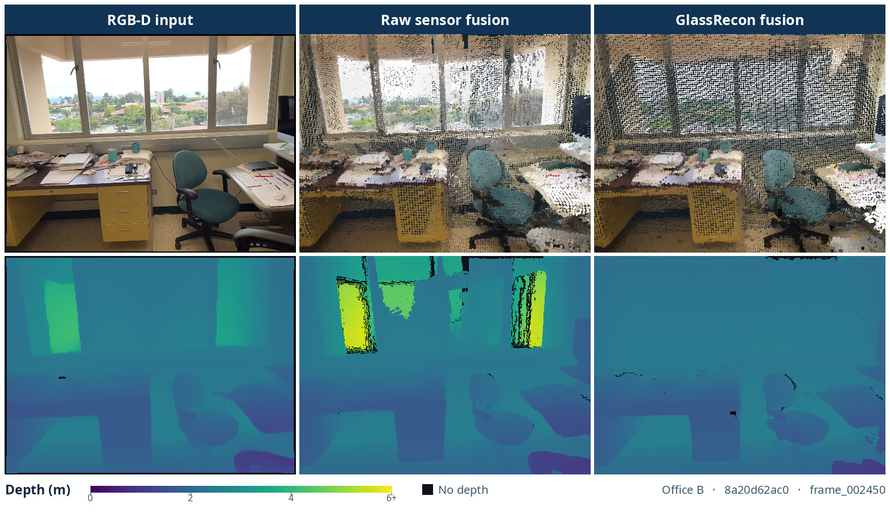
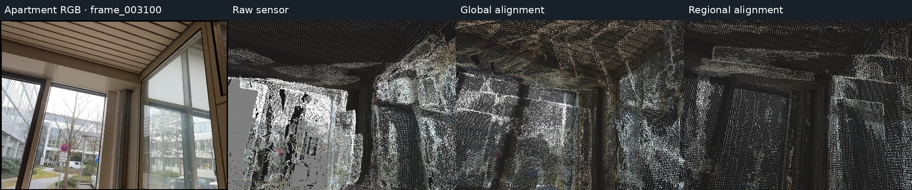
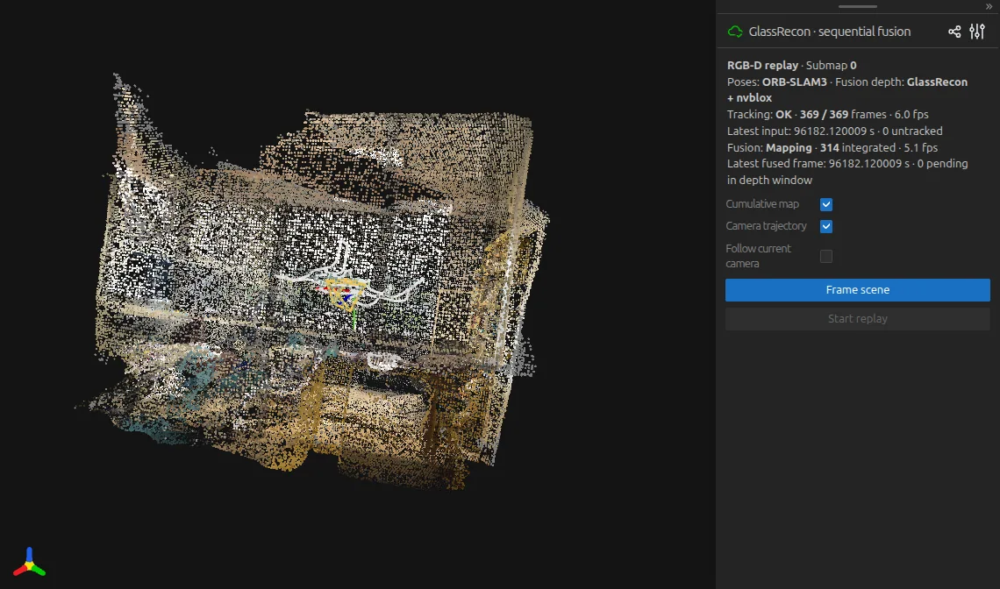

<div align="center">

# Enhancing Glass Surface Reconstruction via Depth Prior for Robot Navigation

### [Project Page](https://jarvisyjw.github.io/GlassRecon/) | [arXiv](https://arxiv.org/abs/2604.18336) | [Code](https://github.com/jarvisyjw/GlassRecon) | [Dataset (Google Drive)](https://drive.google.com/file/d/1u1ODwddeW04bkQ4oda9vgvbKK8MXTQ5N/view?usp=sharing)

[](https://jarvisyjw.github.io/GlassRecon/)

</div>

GlassRecon turns a relative depth prediction from **DA3-LARGE** into metric depth using the RGB-D sensor measurements. It refines depth over a five-frame window and fuses the sequence with **nvblox**. Use supplied camera poses or estimate them from raw RGB-D with **ORB-SLAM3**.

## Dataset

| Task | Data | What you run |
| --- | --- | --- |
| [Quick Start](#quick-start) | [Apartment mapping demo · 394 MiB](https://drive.google.com/file/d/1nArawK8jakviM-ooHapZceBZi2jVkhqZ/view?usp=drive_link) | Fuse 468 RGB frames and their prepared metric depths using supplied camera poses. |
| [Complete Pipeline](#complete-pipeline) | [11 ScanNet++ v2 scenes · 1.85 GiB](https://drive.google.com/drive/folders/1M-jf2Qr56rrLEPYK05y3Rt0m7HGCZBFV?usp=sharing) | Predict depth from RGB, align it to sensor depth and reconstruct with supplied poses or ORB-SLAM3 localization. |
| [Live localization and mapping](#live-localization-and-mapping) | Same 11-scene RGB-D archive | Watch the online ORB-SLAM3 camera trajectory and the growing nvblox point cloud in Viser. |
| [Evaluation](#evaluation) | [GlassRecon.zip · 9.56 GB](https://drive.google.com/file/d/1u1ODwddeW04bkQ4oda9vgvbKK8MXTQ5N/view?usp=sharing) | Evaluate single-image glass depth on 917 annotated indoor RGB-D images. |

The apartment demo and full-scene inputs contain ScanNet++ data. Access is for research collaborators who have signed the [ScanNet++ terms of use](https://scannetpp.mlsg.cit.tum.de/scannetpp/static/scannetpp-terms-of-use.pdf). Users can also [request data from ScanNet++](https://scannetpp.mlsg.cit.tum.de/scannetpp/).

## Usage

### Environment Setup

Run the commands from the repository root. Quick Start uses the nvblox environment, evaluation uses the DA3 environment, and the complete pipeline uses both. The optional ORB-SLAM3 frontend runs in a third environment. These instructions target a CUDA-capable NVIDIA GPU on Linux x86_64. The supplied nvblox wheel targets Ubuntu 24.04 and CUDA 12. [nvblox installation details](docs/nvblox.md) · [ORB-SLAM3 setup](docs/scannetpp.md#orb-slam3-setup)

```bash
git clone https://github.com/jarvisyjw/GlassRecon.git
cd GlassRecon
mkdir -p data
```

**uv**

```bash
# Mapping (Quick Start and complete pipeline)
uv venv --python 3.12 .venv-nvblox
export NVBLOX_PYTHON="$PWD/.venv-nvblox/bin/python"
UV_SKIP_WHEEL_FILENAME_CHECK=1 uv pip install --python "$NVBLOX_PYTHON" -r requirements-nvblox-cu12.txt

# Prediction (evaluation and complete pipeline)
uv venv --python 3.12 .venv-da3
export DA3_PYTHON="$PWD/.venv-da3/bin/python"
uv pip install --python "$DA3_PYTHON" -r requirements-da3-cu12.txt
```

**Conda**

```bash
# Mapping (Quick Start and complete pipeline)
conda create -n glassrecon-nvblox python=3.12 pip -y
conda activate glassrecon-nvblox
export NVBLOX_PYTHON="$CONDA_PREFIX/bin/python"
python -m pip install uv
UV_SKIP_WHEEL_FILENAME_CHECK=1 uv pip install --python "$NVBLOX_PYTHON" -r requirements-nvblox-cu12.txt

# Prediction (evaluation and complete pipeline)
conda create -n glassrecon-da3 python=3.12 pip -y
conda activate glassrecon-da3
export DA3_PYTHON="$CONDA_PREFIX/bin/python"
python -m pip install -r requirements-da3-cu12.txt
```

The commands below use the interpreter paths set above. First inference downloads the DA3-LARGE checkpoint. For an offline run, pass its local directory with `--model-id`. [DA3-LARGE weights](https://huggingface.co/depth-anything/DA3-LARGE)

### Quick Start

Save the apartment archive as `data/mapping_demo.tar.gz`. It contains RGB, final aligned depth in meters, intrinsics and COLMAP poses for the 468 fused apartment frames. [Download the demo](https://drive.google.com/file/d/1nArawK8jakviM-ooHapZceBZi2jVkhqZ/view?usp=drive_link).

```bash
tar -xzf data/mapping_demo.tar.gz -C data
demo=data/mapping_demo
"$NVBLOX_PYTHON" -m glassrecon reconstruct \
  --dataset "$demo" --intrinsics "$demo/intrinsics.json" \
  --depth-source metric --depth-units-per-meter 1 \
  --pose-source file --pose-file "$demo/poses.txt" \
  --backend nvblox --voxel-size 0.02 --sdf-trunc 0.08 \
  --output outputs/apartment_quick

"$NVBLOX_PYTHON" -m glassrecon view --result outputs/apartment_quick --port 8090
```

The run writes `mesh.ply`, `pointcloud.ply` and `trajectory.txt` to `outputs/apartment_quick/`. Use a new output directory for each run. The second command serves the finished map at [localhost:8090](http://127.0.0.1:8090). Over SSH, forward port 8090 to your computer. To watch fusion live, add `--live-view --keep-viewer --viewer-port 8090` to the reconstruction command.

### Complete Pipeline

Download `scannetpp_rgbd_11_scenes.tar.gz` from the shared folder and save it under `data/`. It contains 7,748 registered RGB-D frames across 11 scenes. The example below reconstructs the apartment from all 586 frames. Set `scene` to any ID in the guide to reconstruct another scene. [Google Drive folder](https://drive.google.com/drive/folders/1M-jf2Qr56rrLEPYK05y3Rt0m7HGCZBFV?usp=sharing) · [Scene IDs, frame counts and checksum](docs/scannetpp.md)

```bash
tar -xzf data/scannetpp_rgbd_11_scenes.tar.gz -C data
scene=c0f5742640
sequence="data/scannetpp/$scene"
"$NVBLOX_PYTHON" examples/run_full_pipeline.py \
  --dataset "$sequence" --poses "$sequence/poses.txt" \
  --depth-units-per-meter 1000 --model-python "$DA3_PYTHON" \
  --output "outputs/$scene"

"$NVBLOX_PYTHON" -m glassrecon view --result "outputs/$scene/reconstruction" --port 8090
```

DA3-LARGE predicts relative depth from each RGB image. GlassRecon fits scale and shift to the measured depth, refines the result over five frames, and integrates it with nvblox at the supplied poses. Find the predictions in `predictions/` and the final colored point cloud and mesh in `reconstruction/` inside the selected output folder.

#### ORB-SLAM3 localization and nvblox mapping

In RGB-D mode, ORB-SLAM3 first estimates the camera trajectory from the RGB images and **raw sensor depth**. GlassRecon then uses that trajectory to refine the aligned DA3 depth and fuse it with nvblox. The Office B example uses the same 11-scene archive as above. Install the optional frontend and set `ORB_PYTHON` and `ORB_VOCABULARY` first. [ORB-SLAM3 setup](docs/scannetpp.md#orb-slam3-setup)

```bash
scene=8a20d62ac0
sequence="data/scannetpp/$scene"
result="outputs/${scene}_orb"
"$NVBLOX_PYTHON" examples/run_full_pipeline.py \
  --dataset "$sequence" --depth-units-per-meter 1000 \
  --orb-python "$ORB_PYTHON" --orb-vocabulary "$ORB_VOCABULARY" \
  --model-python "$DA3_PYTHON" --output "$result"

"$NVBLOX_PYTHON" -m glassrecon view --result "$result/reconstruction" --port 8090
```

`localization/poses.txt` contains the final optimized camera-to-world trajectory. `localization/summary.json` reports tracking coverage. Open `reconstruction/pointcloud.ply` for the dense colored map. [Run localization alone](docs/scannetpp.md#export-an-orb-slam3-trajectory)



ORB-SLAM3 localized all 369 Office B frames in this run on the prepared sequence (approximately 6 Hz). Both maps use that trajectory. At the window, raw sensor fusion retains points behind the glass. GlassRecon recovers a more continuous surface at the pane. The bottom row shows measured depth and the two rendered depths from the same camera on a common scale. [Office and conference-room point clouds](assets/orb-slam3-prepared-scenes.jpg) · [Reproduce the comparison](docs/scannetpp.md#compare-raw-and-glassrecon-fusion)

For an existing SLAM or VIO trajectory, pass `--poses path/to/poses.txt`. Each row contains `timestamp tx ty tz qx qy qz qw`, with time in seconds and camera-to-world translation in meters. Omitting both pose options selects the built-in RGB-D odometry.

#### Fused point cloud comparison with supplied poses

[](experiments/results/scannetpp_v2/pointcloud_videos/c0f5742640.mp4)

<video src="experiments/results/scannetpp_v2/pointcloud_videos/c0f5742640.mp4" controls preload="none" width="100%"></video>

[Apartment video](experiments/results/scannetpp_v2/pointcloud_videos/c0f5742640.mp4) · [Conference room](experiments/results/scannetpp_v2/pointcloud_videos/791a5c253d_interior.jpg) · [Office](experiments/results/scannetpp_v2/pointcloud_videos/8a20d62ac0_interior.jpg)

### Live localization and mapping

Replay an RGB-D recording at its capture timestamps. ORB-SLAM3 estimates each pose from the incoming RGB and raw sensor depth. In parallel, DA3-LARGE predicts relative depth, GlassRecon aligns and refines it over five mapping frames, and nvblox fuses the colored surface. The example uses Office B from the prepared archive and the same three environments as the complete ORB-SLAM3 pipeline. [Data and ORB-SLAM3 setup](docs/scannetpp.md#orb-slam3-setup)

```bash
OMP_NUM_THREADS=1 OPENBLAS_NUM_THREADS=1 "$NVBLOX_PYTHON" -m glassrecon live \
  --dataset data/scannetpp/8a20d62ac0 --depth-units-per-meter 1000 \
  --orb-python "$ORB_PYTHON" --orb-vocabulary "$ORB_VOCABULARY" \
  --model-python "$DA3_PYTHON" --output outputs/office_live --port 8091
```

Open the viewer and click **Start replay**. The camera frustum follows the latest pose. The point cloud first appears when five mapping frames have arrived, then refreshes every three fused frames. Drag to orbit, click **Frame scene** to fit the growing map again, or enable **Follow current camera**. Over VS Code Remote SSH, forward port `8091` in the **Ports** panel first. [Open Viser](http://127.0.0.1:8091)



Time-lapse of the Office B replay. The panel shows the latest input and fused timestamps alongside their frame rates.

Tracking processes every input frame. When dense fusion falls behind, the two-frame mapping queue keeps the newest waiting frames. The summary reports tracking losses and mapping drops separately. Use `--playback-rate 0.5` for half-speed replay or `--max-frames 60` for a shorter run. Live alignment uses 12 trials per region. Set `--alignment-iterations 100` for the offline fitting budget.

Each continuous tracking segment has its own `segment_000/`, `segment_001/`, etc., with `trajectory.txt` for all tracked poses, `fused_trajectory.txt` for the poses used by nvblox, and the resulting `pointcloud.ply` and `mesh.ply`. Online fusion uses the pose available at frame arrival and disables loop closure. For a map built with the final loop-optimized trajectory, use the [complete pipeline](#orb-slam3-localization-and-nvblox-mapping).

The viewer stays open after export. Click **Replay** to start tracking and mapping again. Each repeat writes a fresh result under `replays/run_002/`, `replays/run_003/` and so on. For an unattended single run, pass `--autoplay --exit-after-run`. Use the following command to reopen a saved segment later.

```bash
"$NVBLOX_PYTHON" -m glassrecon view --result outputs/office_live/segment_000 --port 8090
```

## Evaluation

Save [GlassRecon.zip](https://drive.google.com/file/d/1u1ODwddeW04bkQ4oda9vgvbKK8MXTQ5N/view?usp=sharing) in `data/`. The benchmark contains 917 RGB JPEGs, sensor depth PNGs, glass masks, camera intrinsics and reference depths. The evaluator matches files by image stem and uses the filtered reference maps in `evaluation_depths/depths_npy/`. Both stored depth formats use **0.00025 meters per unit**.

```bash
unzip -q data/GlassRecon.zip -d data
dataset=data/GlassRecon
"$DA3_PYTHON" -m glassrecon predict \
  --image-folder "$dataset/images" --model da3 --model-id depth-anything/DA3-LARGE \
  --device cuda --output outputs/benchmark_predictions

"$DA3_PYTHON" eval.py \
  --image-folder "$dataset/images" --pred-folder outputs/benchmark_predictions \
  --sensor-depth-folder "$dataset/sensor_depths" \
  --gt-depth-folder "$dataset/evaluation_depths/depths_npy" \
  --depth-scale 0.00025 --outdir outputs/benchmark_eval
```

Read per-image and mean AbsRel and δ < 1.25 for global and regional alignment in `outputs/benchmark_eval/eval_results.txt`. [Evaluation script](eval.py) · [Original evaluation code](https://github.com/JMamie/GlassRecon)

## Sample demo


The three panels show the input RGB, the raw-sensor reconstruction depth and the GlassRecon reconstruction depth. Every fifth frame was held out for these comparisons. The complete pipeline above processes the full sequence.


Both apartment point clouds use the same 468 frames, camera poses and nvblox settings. Each panel fits the whole cloud and includes a one-meter scale bar. [Explore the aligned comparisons for all three scenes](https://jarvisyjw.github.io/GlassRecon/#reconstructions).

## License

The original GlassRecon reconstruction code is licensed under the GNU General Public License, version 2 only (`GPL-2.0-only`). [License text](LICENSE)

The optional ORB-SLAM3 frontend uses upstream ORB-SLAM3 (GPLv3) through the separately installed `pyorbslam3` bindings (GPL-3.0-or-later). [ORB-SLAM3 license and citation](https://github.com/UZ-SLAMLab/ORB_SLAM3#1-license) · [Python binding](https://pypi.org/project/pyorbslam3/0.1.3/)

The evaluation scripts `eval.py` and `alignment_functions.py` come from the original evaluation repository and are outside this license grant. [Evaluation code upstream](https://github.com/JMamie/GlassRecon)

The code license excludes datasets and model weights. DA3-LARGE weights are licensed under CC BY-NC 4.0. The ScanNet++ inputs in the mapping demo and complete scene archive are subject to the ScanNet++ terms of use. [DA3-LARGE model card](https://huggingface.co/depth-anything/DA3-LARGE) · [ScanNet++ terms](https://scannetpp.mlsg.cit.tum.de/scannetpp/static/scannetpp-terms-of-use.pdf)

## Citation

If you use GlassRecon in your research, please cite this paper.

```bibtex
@article{zheng2026enhancing,
  title={Enhancing Glass Surface Reconstruction via Depth Prior for Robot Navigation},
  author={Zheng, Jiamin and Yu, Jingwen and Chen, Guangcheng and Zhang, Hong},
  journal={arXiv preprint arXiv:2604.18336},
  year={2026}
}
```

## Contribution

Full credit for the GlassRecon dataset annotations and evaluation code goes to Jiamin Zheng.
