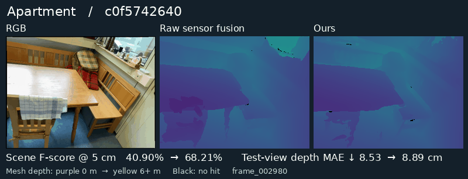
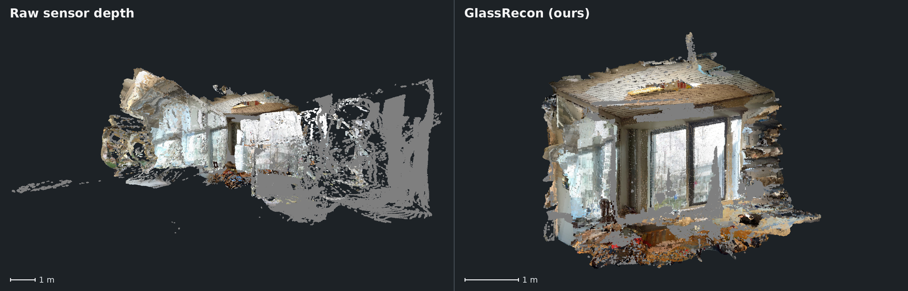

<div align="center">

# Enhancing Glass Surface Reconstruction via Depth Prior for Robot Navigation

### [Project Page](https://jarvisyjw.github.io/GlassRecon/) | [arXiv](https://arxiv.org/abs/2604.18336) | [Code](https://github.com/jarvisyjw/GlassRecon) | [Dataset (Google Drive)](https://drive.google.com/file/d/1u1ODwddeW04bkQ4oda9vgvbKK8MXTQ5N/view?usp=sharing)

[](https://jarvisyjw.github.io/GlassRecon/)

</div>

GlassRecon turns a relative depth prediction from **DA3-LARGE** into metric depth using the RGB-D sensor measurements. It refines depth over a five-frame window and fuses the sequence with **nvblox**.

## Dataset

| Task | Data | What you run |
| --- | --- | --- |
| [Quick Start](#quick-start) | [Apartment mapping demo · 394 MiB](https://drive.google.com/file/d/1nArawK8jakviM-ooHapZceBZi2jVkhqZ/view?usp=drive_link) | Fuse 468 RGB frames and their prepared metric depths using supplied camera poses. |
| [Complete Pipeline](#complete-pipeline) | [ScanNet++ v2 scene inputs and preparation](docs/scannetpp.md) | Start with RGB, measured sensor depth, intrinsics and poses. Predict depth, align it and reconstruct the scene. |
| [Evaluation](#evaluation) | [GlassRecon.zip · 9.56 GB](https://drive.google.com/file/d/1u1ODwddeW04bkQ4oda9vgvbKK8MXTQ5N/view?usp=sharing) | Evaluate single-image glass depth on 917 annotated indoor RGB-D images. |

The apartment demo and full-scene inputs contain ScanNet++ data. Access is for research collaborators who have signed the [ScanNet++ terms of use](https://scannetpp.mlsg.cit.tum.de/scannetpp/static/scannetpp-terms-of-use.pdf). Users can also [request data from ScanNet++](https://scannetpp.mlsg.cit.tum.de/scannetpp/).

## Usage

### Environment Setup

Run the commands from the repository root. Quick Start uses the nvblox environment, evaluation uses the DA3 environment, and the complete pipeline uses both. These instructions target a CUDA-capable NVIDIA GPU on Linux x86_64. The supplied nvblox wheel targets Ubuntu 24.04 and CUDA 12. [nvblox installation details](docs/nvblox.md)

```bash
git clone https://github.com/jarvisyjw/GlassRecon.git
cd GlassRecon
mkdir -p data
```

**uv**

```bash
# Mapping (Quick Start and complete pipeline)
uv venv --python 3.12 .venv-nvblox
export NVBLOX_PYTHON="$PWD/.venv-nvblox/bin/python"
UV_SKIP_WHEEL_FILENAME_CHECK=1 uv pip install --python "$NVBLOX_PYTHON" -r requirements-nvblox-cu12.txt

# Prediction (evaluation and complete pipeline)
uv venv --python 3.12 .venv-da3
export DA3_PYTHON="$PWD/.venv-da3/bin/python"
uv pip install --python "$DA3_PYTHON" -r requirements-da3-cu12.txt
```

**Conda**

```bash
# Mapping (Quick Start and complete pipeline)
conda create -n glassrecon-nvblox python=3.12 pip -y
conda activate glassrecon-nvblox
export NVBLOX_PYTHON="$CONDA_PREFIX/bin/python"
python -m pip install uv
UV_SKIP_WHEEL_FILENAME_CHECK=1 uv pip install --python "$NVBLOX_PYTHON" -r requirements-nvblox-cu12.txt

# Prediction (evaluation and complete pipeline)
conda create -n glassrecon-da3 python=3.12 pip -y
conda activate glassrecon-da3
export DA3_PYTHON="$CONDA_PREFIX/bin/python"
python -m pip install -r requirements-da3-cu12.txt
```

The commands below use the interpreter paths set above. First inference downloads the DA3-LARGE checkpoint. For an offline run, pass its local directory with `--model-id`. [DA3-LARGE weights](https://huggingface.co/depth-anything/DA3-LARGE)

### Quick Start

Save the apartment archive as `data/mapping_demo.tar.gz`. It contains RGB, final aligned depth in meters, intrinsics and COLMAP poses for the 468 fused apartment frames. [Download the demo](https://drive.google.com/file/d/1nArawK8jakviM-ooHapZceBZi2jVkhqZ/view?usp=drive_link).

```bash
tar -xzf data/mapping_demo.tar.gz -C data
demo=data/mapping_demo
"$NVBLOX_PYTHON" -m glassrecon reconstruct \
  --dataset "$demo" --intrinsics "$demo/intrinsics.json" \
  --depth-source metric --depth-units-per-meter 1 \
  --pose-source file --pose-file "$demo/poses.txt" \
  --backend nvblox --voxel-size 0.02 --sdf-trunc 0.08 \
  --output outputs/apartment_quick

"$NVBLOX_PYTHON" -m glassrecon view --result outputs/apartment_quick --port 8090
```

The run writes `mesh.ply`, `pointcloud.ply` and `trajectory.txt` to `outputs/apartment_quick/`. Use a new output directory for each run. The second command serves the finished map at [localhost:8090](http://127.0.0.1:8090). Over SSH, forward port 8090 to your computer. To watch fusion live, add `--live-view --keep-viewer --viewer-port 8090` to the reconstruction command.

### Complete Pipeline

Prepare the three scenes under `data/scannetpp/` using the [ScanNet++ scene guide](docs/scannetpp.md). Select the apartment (`c0f5742640`), conference room (`791a5c253d`) or office (`8a20d62ac0`). This example processes all 586 apartment frames.

```bash
scene=c0f5742640
sequence="data/scannetpp/$scene"
"$NVBLOX_PYTHON" examples/run_full_pipeline.py \
  --dataset "$sequence" --poses "$sequence/poses.txt" \
  --depth-units-per-meter 1000 --model-python "$DA3_PYTHON" \
  --output "outputs/$scene"

"$NVBLOX_PYTHON" -m glassrecon view --result "outputs/$scene/reconstruction" --port 8090
```

DA3-LARGE predicts relative depth from each RGB image. GlassRecon fits scale and shift to the measured depth, refines the result over five frames, and integrates it with nvblox at the supplied poses. Find the predictions in `predictions/` and the final colored point cloud and mesh in `reconstruction/` inside the selected output folder.

#### Mapping with estimated poses

To use RGB-D odometry, omit `--poses`. To use an external SLAM or VIO trajectory, pass `--poses path/to/poses.txt`. Supply synchronized camera-to-world poses as `timestamp tx ty tz qx qy qz qw` with translations in meters.

#### Fused point cloud comparison

[](experiments/results/scannetpp_v2/pointcloud_videos/c0f5742640.mp4)

<video src="experiments/results/scannetpp_v2/pointcloud_videos/c0f5742640.mp4" controls preload="none" width="100%"></video>

[Apartment video](experiments/results/scannetpp_v2/pointcloud_videos/c0f5742640.mp4) · [Conference room](experiments/results/scannetpp_v2/pointcloud_videos/791a5c253d_interior.jpg) · [Office](experiments/results/scannetpp_v2/pointcloud_videos/8a20d62ac0_interior.jpg)

## Evaluation

Save [GlassRecon.zip](https://drive.google.com/file/d/1u1ODwddeW04bkQ4oda9vgvbKK8MXTQ5N/view?usp=sharing) in `data/`. The benchmark contains 917 RGB JPEGs, sensor depth PNGs, glass masks, camera intrinsics and reference depths. The evaluator matches files by image stem and uses the filtered reference maps in `evaluation_depths/depths_npy/`. Both stored depth formats use **0.00025 meters per unit**.

```bash
unzip -q data/GlassRecon.zip -d data
dataset=data/GlassRecon
"$DA3_PYTHON" -m glassrecon predict \
  --image-folder "$dataset/images" --model da3 --model-id depth-anything/DA3-LARGE \
  --device cuda --output outputs/benchmark_predictions

"$DA3_PYTHON" eval.py \
  --image-folder "$dataset/images" --pred-folder outputs/benchmark_predictions \
  --sensor-depth-folder "$dataset/sensor_depths" \
  --gt-depth-folder "$dataset/evaluation_depths/depths_npy" \
  --depth-scale 0.00025 --outdir outputs/benchmark_eval
```

Read per-image and mean AbsRel and δ < 1.25 for global and regional alignment in `outputs/benchmark_eval/eval_results.txt`. [Evaluation script](eval.py) · [Original evaluation code](https://github.com/JMamie/GlassRecon)

## Sample demo



The three panels show the input RGB, the raw-sensor reconstruction depth and the GlassRecon reconstruction depth. Every fifth frame was held out for these comparisons. The complete pipeline above processes the full sequence.



Both apartment point clouds use the same 468 frames, camera poses and nvblox settings. Each panel fits the whole cloud and includes a one-meter scale bar. [Explore the aligned comparisons for all three scenes](https://jarvisyjw.github.io/GlassRecon/#reconstructions).

## Citation

If you use GlassRecon in your research, please cite this paper.

```bibtex
@article{zheng2026enhancing,
  title={Enhancing Glass Surface Reconstruction via Depth Prior for Robot Navigation},
  author={Zheng, Jiamin and Yu, Jingwen and Chen, Guangcheng and Zhang, Hong},
  journal={arXiv preprint arXiv:2604.18336},
  year={2026}
}
```
