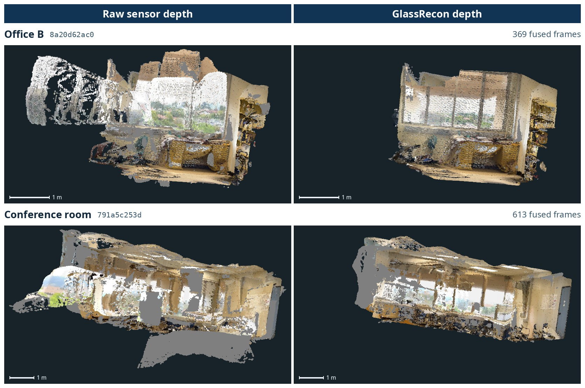

# Reconstruct 11 ScanNet++ v2 scenes

Each prepared iPhone scene contains registered RGB-D frames, camera intrinsics and a COLMAP reference trajectory. For mapping, use the supplied trajectory or estimate one from the raw RGB-D sequence with ORB-SLAM3. The table counts prepared frames. [Interactive scene comparisons](https://jarvisyjw.github.io/GlassRecon/#reconstructions)

| Scene | ScanNet++ v2 ID | Prepared RGB-D frames |
| --- | --- | ---: |
| Lounge A | `08bd80ce2a` | 1,302 |
| Bedroom | `0a76e06478` | 962 |
| Lounge B | `1b379f1114` | 660 |
| Apartment B | `33f78338cd` | 826 |
| Kitchen | `45ba9ea301` | 191 |
| Winter garden | `511061232` | 565 |
| Conference room | `791a5c253d` | 694 |
| Lounge C | `7f68c514bd` | 969 |
| Office B | `8a20d62ac0` | 369 |
| Apartment | `c0f5742640` | 586 |
| Office | `fd361ab85f` | 624 |

The archive contains 7,748 frames. The project page features the apartment (`c0f5742640`), conference room (`791a5c253d`) and office B (`8a20d62ac0`).

## Get the inputs

Set up the DA3 and nvblox environments and run the commands from the GlassRecon repository root. [Environment setup](../README.md#environment-setup)

**Prepared scene archive.** Save `scannetpp_rgbd_11_scenes.tar.gz` (1.85 GiB) from the [Google Drive folder](https://drive.google.com/drive/folders/1M-jf2Qr56rrLEPYK05y3Rt0m7HGCZBFV?usp=sharing) under `data/`. Verify its checksum and unpack it once for all 11 scenes. The separate [Quick Start archive](../README.md#quick-start) provides the final metric depths for the 468-frame apartment demo.

```bash
mkdir -p data
echo 'c6d40ea57cf0ecffba7c476397e2bb41e57b0a762cda76ab5a1ccb64086ea622  data/scannetpp_rgbd_11_scenes.tar.gz' | sha256sum -c -
tar -xzf data/scannetpp_rgbd_11_scenes.tar.gz -C data
```

**Official ScanNet++ release.** Request access to v2 and download the scenes you want from the table above. For each scene, get `iphone/rgb.mkv`, `iphone/rgb_mask.mkv`, `iphone/depth.bin`, `iphone/pose_intrinsic_imu.json` and `iphone/colmap/{cameras,images}.txt`. The official downloader extracts these under `data/<scene-id>/iphone/`. [ScanNet++ access](https://scannetpp.mlsg.cit.tum.de/scannetpp/) · [Data documentation](https://scannetpp.mlsg.cit.tum.de/scannetpp/documentation)

Set `SCANNETPP_ROOT` to the directory containing the official `data/` folder. For Conda, activate `glassrecon-nvblox` to use the installed `uv` command.

```bash
export SCANNETPP_ROOT=/absolute/path/to/scannetpp
scene=c0f5742640  # Choose any ID from the table
```

If the scene already contains decoded `iphone/rgb/`, `iphone/rgb_masks/` and `iphone/depth/`, go directly to the conversion step. Otherwise install FFmpeg on your PATH and decode the three streams using the [official toolbox](https://github.com/scannetpp/scannetpp/tree/21ba1dc724e0d09c6a1f72b0d63944f5363eb675/iphone).

```bash
mkdir -p data
git clone https://github.com/scannetpp/scannetpp.git data/scannetpp-toolbox
(
  cd data/scannetpp-toolbox
  git checkout --quiet 21ba1dc724e0d09c6a1f72b0d63944f5363eb675
  cp iphone/configs/prepare_iphone_data.yml.template iphone/configs/prepare_iphone_data.yaml
  uv pip install --python "$NVBLOX_PYTHON" hydra-core munch lz4 imageio
  "$NVBLOX_PYTHON" -m iphone.prepare_iphone_data \
    data_root="$SCANNETPP_ROOT" "scene_ids=['$scene']" \
    +extract_only_rgb_in_colmap=false +output_root=null
)
```

Convert the decoded frames into registered 512 × 384 RGB-D sequences. The converter applies the official validity masks, preserves the sensor depth in millimeters and writes camera-to-world poses.

```bash
uv pip install --python "$NVBLOX_PYTHON" -e '.[scannetpp]'
"$NVBLOX_PYTHON" examples/prepare_scannetpp.py \
  --scene-dir "$SCANNETPP_ROOT/data/$scene" --output "data/scannetpp/$scene"
```

## ORB-SLAM3 setup

For estimated poses, add a Python 3.12 tracking environment to the DA3 and nvblox environments from the README. Use either setup below from the repository root on Linux x86_64. [ORB-SLAM3](https://github.com/UZ-SLAMLab/ORB_SLAM3) · [pyorbslam3 wheel](https://pypi.org/project/pyorbslam3/0.1.3/)

**uv**

```bash
uv venv --python 3.12 .venv-orb
export ORB_PYTHON="$PWD/.venv-orb/bin/python"
uv pip install --python "$ORB_PYTHON" -e '.[orbslam3]'
```

**Conda**

```bash
conda create -n glassrecon-orb python=3.12 pip -y
conda activate glassrecon-orb
export ORB_PYTHON="$CONDA_PREFIX/bin/python"
"$ORB_PYTHON" -m pip install -e '.[orbslam3]'
```

Download the ORB feature vocabulary once. The frontend generates camera settings from the sequence calibration and timestamps.

```bash
mkdir -p data/orbslam3
orb_revision=4452a3c4ab75b1cde34e5505a36ec3f9edcdc4c4
curl -fL "https://raw.githubusercontent.com/UZ-SLAMLab/ORB_SLAM3/$orb_revision/Vocabulary/ORBvoc.txt.tar.gz" \
  -o data/orbslam3/ORBvoc.txt.tar.gz
echo 'ff2d0e82a69a8f4c5c002e3a0dff82a00e5872e1659fac1b996f41166b92693b  data/orbslam3/ORBvoc.txt.tar.gz' | sha256sum -c -
tar -xzf data/orbslam3/ORBvoc.txt.tar.gz -C data/orbslam3 ORBvoc.txt
export ORB_VOCABULARY="$PWD/data/orbslam3/ORBvoc.txt"
```

## Run a scene

Both input routes produce the same layout. Under `data/scannetpp/<scene-id>/`, `rgb/`, `depth/` and `masks/` share frame names. `rgb.txt` and `depth.txt` associate those files with timestamps. `intrinsics.json` describes the rectified camera, and `poses.txt` gives its camera-to-world trajectory.

```bash
scene=c0f5742640
sequence="data/scannetpp/$scene"
"$NVBLOX_PYTHON" examples/run_full_pipeline.py \
  --dataset "$sequence" --poses "$sequence/poses.txt" \
  --depth-units-per-meter 1000 --model-python "$DA3_PYTHON" \
  --output "outputs/$scene"
"$NVBLOX_PYTHON" -m glassrecon view --result "outputs/$scene/reconstruction" --port 8090
```

Set `scene` to the ID of any prepared scene. The runner saves per-image DA3 depth in `predictions/`, the refined metric inputs in `reconstruction/metric_depths/`, and the colored point cloud and mesh in `reconstruction/{pointcloud,mesh}.ply`. The viewer opens at [localhost:8090](http://127.0.0.1:8090).

## Export an ORB-SLAM3 trajectory

To export just the trajectory, use the prepared Office B sequence or another scene ID from the table. To follow localization with DA3 depth prediction and nvblox fusion, use the complete pipeline. [End-to-end example](../README.md#orb-slam3-localization-and-nvblox-mapping)

```bash
scene=8a20d62ac0
sequence="data/scannetpp/$scene"
tracking="outputs/${scene}_poses"
"$ORB_PYTHON" -m glassrecon localize \
  --dataset "$sequence" --vocabulary "$ORB_VOCABULARY" \
  --depth-units-per-meter 1000 --output "$tracking"
```

The frontend reads the registered RGB images, sensor depth in millimeters and `intrinsics.json`. After optimization, `poses.txt` contains the successfully tracked timestamps in the largest connected ORB map. In `summary.json`, `coverage` is the fraction of associated RGB-D frames retained in that trajectory (`localized_frames / associated`). Tracking loss can leave parts of a recording in separate maps. The end-to-end ORB command fuses frames with an exact timestamp match.

You can reuse `poses.txt` as an external trajectory on the same sequence. For evaluation against the supplied COLMAP poses, align the two trajectories with a single rigid transform at matching timestamps and report coverage alongside the error.

## Compare raw and GlassRecon fusion

The complete ORB-SLAM3 pipeline produces the GlassRecon map in the README. After that run, fuse the measured sensor depth using the same trajectory to reproduce the raw-depth baseline. Both commands use 2 cm voxels and 8 cm truncation. For the conference room, set `scene=791a5c253d` in both commands.

```bash
scene=8a20d62ac0
sequence="data/scannetpp/$scene"
result="outputs/${scene}_orb"
"$NVBLOX_PYTHON" -m glassrecon reconstruct \
  --dataset "$sequence" --intrinsics "$sequence/intrinsics.json" \
  --valid-mask-dir "$sequence/masks" --depth-source sensor --depth-units-per-meter 1000 \
  --pose-source file --pose-file "$result/localization/poses.txt" --pose-max-difference 0 \
  --backend nvblox --voxel-size 0.02 --sdf-trunc 0.08 --output "$result/raw_sensor"
```



The prepared archive samples the original recordings at approximately 6 Hz. Each pair of point clouds shares a trajectory, viewpoint and scale. ORB-SLAM3 tracking and loop closure run asynchronously, so the final trajectory and frame count can vary between runs.

For the three-scene figure, ORB-SLAM3 tracked the original iPhone stream at approximately 30 Hz. nvblox then fused 468 apartment, 555 conference-room and 295 office frames. Each raw-depth and GlassRecon-depth pair uses the same final ORB trajectory, fusion frames and 2 cm voxels. The figure reports surface F-score at 5 cm against the independent laser scan. [Three-scene reconstruction comparison](../assets/orb-slam3-nvblox.jpg)
